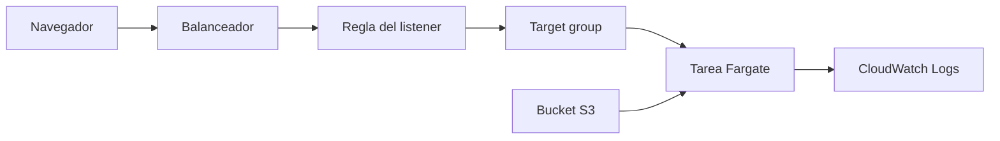

# Infraestructura en AWS

`http://ucm-proyecto-final-alb-1076017167.eu-west-1.elb.amazonaws.com/ucm-victor-del-pino-ucm/`

El navegador entra por el balanceador del taller. Una regla lleva el tráfico a una tarea de Fargate, en una subred privada. Esa tarea lee la tabla de recomendaciones en S3 y escribe sus logs en CloudWatch.

La regla usa la prioridad que guarda SSM, para no pisar la de otro alumno. La tarea no tiene IP pública: entra en la VPC del taller con su security group. El rol de ejecución arranca la tarea y el rol de la tarea lee el bucket.

## Servicios

| Servicio | Nombre | Para qué |
| --- | --- | --- |
| VPC | `ucm-proyecto-final-vpc` | Red del taller. La tarea va en las subredes privadas |
| Security group | `ucm-proyecto-final-tareas` | Permite el tráfico de la tarea |
| Application Load Balancer | `ucm-proyecto-final-alb` | Recibe las peticiones en el puerto 80 |
| Regla del listener | Prioridad 30, ruta `/ucm-victor-del-pino-ucm` | Envía esa ruta al target group de este alumno |
| Target group | `ucm-victor-del-pino-ucm-tg` | Comprueba `/health` y reenvía al puerto 8000 |
| ECS, clúster | `ucm-victor-del-pino-ucm-cluster` | Agrupa la tarea de Fargate |
| ECS, servicio y tarea | `ucm-victor-del-pino-ucm-api` | Ejecuta la página. Una tarea, 0,25 vCPU y 512 MB |
| S3 | `ucm-victor-del-pino-ucm-juegos` | Guarda `recomendaciones.json` y el código de la página |
| CloudWatch Logs | `/ecs/ucm-victor-del-pino-ucm` | Guarda la salida del contenedor, 7 días |
| Systems Manager | `/ucm/proyecto-final/victor_del_pino_ucm/prioridad` | Da la prioridad 30 de la regla |
| IAM | `ucm-ecs-ejecucion` | Arranca la tarea y escribe los logs |
| IAM | `ucm-ecs-tarea` | Permite a la tarea leer el bucket |

La VPC, el balanceador, el security group y los dos roles ya existían en el taller. Terraform crea el bucket, el clúster, la tarea, el target group, la regla y el log group.

## Problemas del despliegue y diferencias con las prácticas

Las prácticas dejan la imagen `latest` del repositorio `ucm-proyecto-final-fastapi`, guardan CSV en S3 y los consultan con Athena. Avisan por correo con Lambda, SNS y EventBridge, y meten la API key desde SSM.

Aquí la cuenta rechazó subir capas a ese repositorio. También rechazó crear un bucket de S3 Vectors y una tabla de DynamoDB, que eran las dos primeras opciones para guardar las recomendaciones. El clúster, el target group y la prioridad 30 eran los de la API de menús, así que esa práctica tenía que estar destruida: dos reglas no comparten prioridad.

El primer arranque empaquetaba la aplicación y el modelo en un tar de unos 400 MB. Falló por finales de línea de Windows en el script y por ficheros ocultos de macOS dentro del paquete. La tarea no llegaba a estar sana.

La solución fue una imagen pública de Python, en ARM64. Al arrancar instala FastAPI y baja de S3 el código y `recomendaciones.json`. Sin el modelo, la tarea usa 512 MB, el mismo tamaño que las prácticas. No hay Athena, Glue, Lambda ni SNS. La consulta lee un JSON en el proceso.
